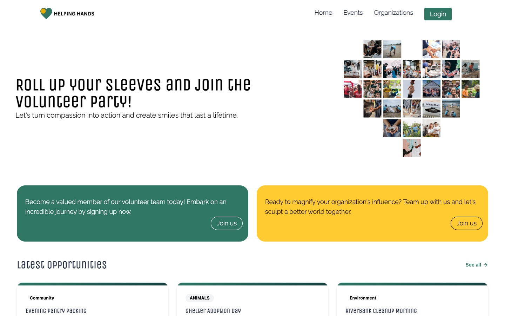
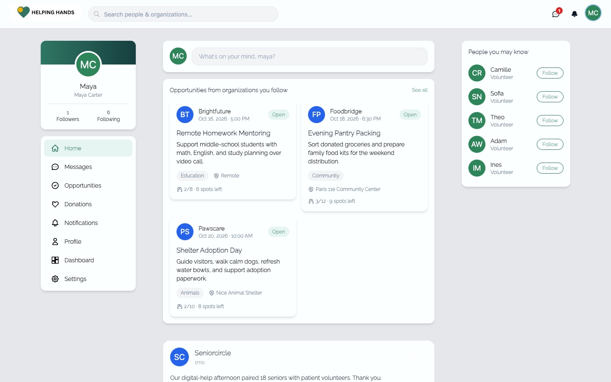
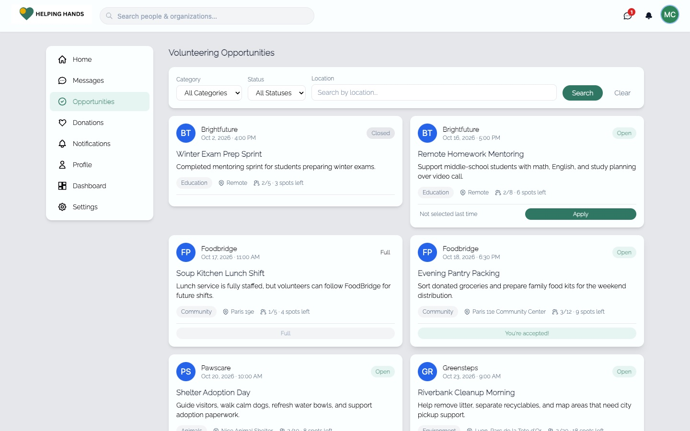
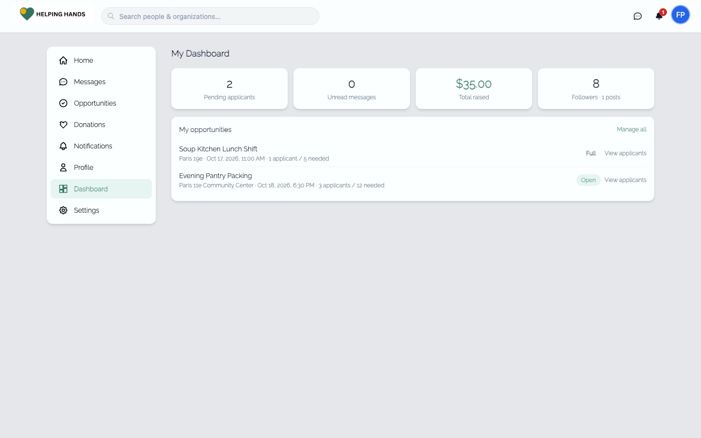
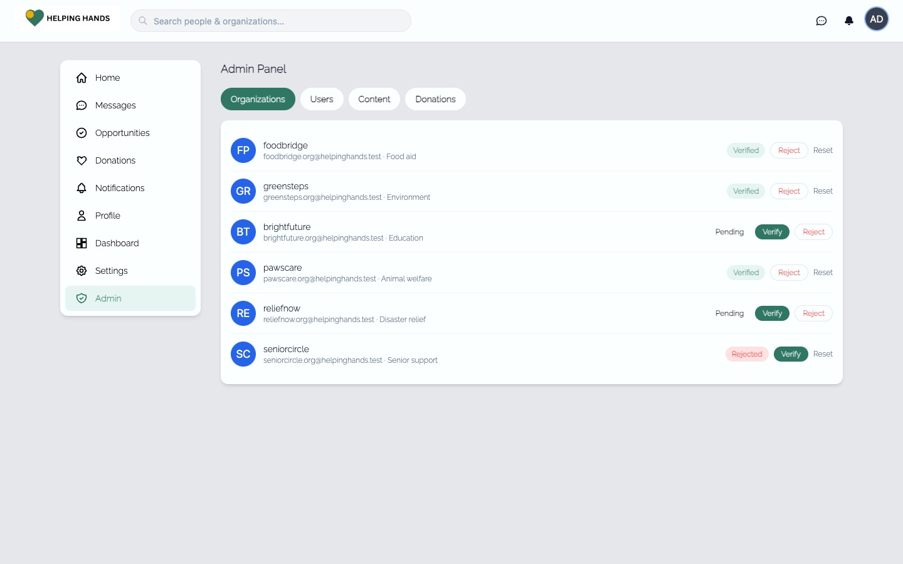
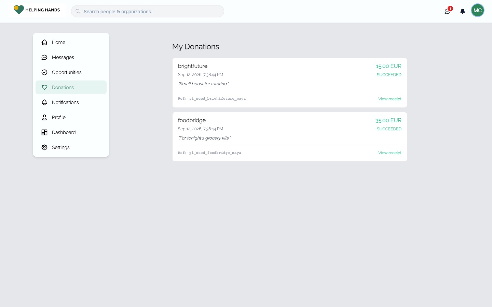

# HelpingHands


A full-stack volunteering platform that connects volunteers with organizations. Volunteers discover opportunities, apply, follow organizations, chat in real time, and donate; organizations post opportunities, manage applicants, and build a following; admins moderate the platform.

> Full-stack monorepo: Spring Boot API + Angular SPA + MySQL, containerized so the whole stack runs with a single command. Started during my 2023 full-stack internship at **IBM**, then rebuilt and extended.

<p align="center">
  
</p>

| Landing page | Volunteer feed | Opportunities |
|---|---|---|
|  |  |  |
| **Organization dashboard** | **Admin moderation** | **Donations (Stripe test mode)** |
|  |  |  |

## Tech stack

| Layer | Technology |
|-------|-----------|
| Backend | Java 17, Spring Boot 3.1, Spring Security (JWT), Spring Data JPA, WebSocket/STOMP |
| Frontend | Angular 16, TypeScript, RxJS |
| Database | MySQL 8 |
| Realtime | STOMP over WebSocket (SockJS), with HTTP-backed message delivery for reliability |
| Payments | Stripe (test mode) |
| Infrastructure | Docker, docker-compose, nginx reverse proxy |

## Quick start

The entire stack runs with one command. You only need Docker installed.

```bash
git clone https://github.com/miaaa3/Helping-handss.git
cd Helping-handss
docker compose up --build
```

Then open **http://localhost:8081** and sign in with a seeded account:

- Volunteer — `maya.volunteer@helpinghands.test`
- Organization — `foodbridge.org@helpinghands.test`
- Admin — `admin@helpinghands.test`

All demo accounts share the password `Password123!`. Sample data (8 volunteers, 6 organizations, opportunities, posts, follows) seeds automatically on first run.

## Features

**Volunteers** browse and search opportunities, get personalized recommendations and suggested organizations based on their interests, apply to opportunities, follow organizations and other users, post to a social feed with likes and comments, message organizations in real time, and donate.

**Organizations** post and manage opportunities, review and accept or reject applicants, build a following, and track engagement from a dashboard.

**Admins** moderate users, organizations, and posts, and verify organizations before their opportunities go public.

**Personalized discovery** matches volunteers to opportunities and organizations by the interest categories they pick: the Opportunities page shows a "Recommended for you" strip, and the home feed suggests organizations that post in those categories.

**Following** works Instagram-style: a follow request starts as *pending* and only counts once the target accepts, so follower counts and feeds reflect real, accepted relationships (self-follows are blocked). Profiles show a **Follow Back** action when someone already follows you, an inline, clickable followers/following list, and a "started following you" notification that fires only once the request is actually accepted.

**Messaging** sends over HTTP so it's persisted before it's ever shown, and delivered live to the other person over WebSocket when they're online — so messages don't silently drop on a flaky connection or disappear on refresh. Unread conversations show a live-updating count on the Messages icon.

**Notifications** are grouped in a single dropdown with per-item timestamps, a scrollable list, an unread badge, and an empty state, covering follow requests, accepted follows, likes, and comments.

## Architecture

The repository is a monorepo with two applications and one orchestration layer:

```
HelpingHands/
├── frontend/            Angular SPA, served by nginx
├── backend/             Spring Boot REST + WebSocket API
└── docker-compose.yml   MySQL + backend + frontend, wired together
```

In the container setup, nginx serves the Angular build and reverse-proxies API, auth, upload, and WebSocket traffic to the backend, so the whole app is same-origin — no CORS friction, and deployment is a single set of images. The database schema is managed by JPA (`ddl-auto=update`); no manual migrations are needed for local runs.

## Running without Docker

For local development against your own MySQL and live-reload frontend, see [`PROJECT_GUIDE.md`](PROJECT_GUIDE.md), which covers prerequisites, environment variables, API endpoints, and common issues.

## Roadmap

- [x] Containerized stack (Docker + docker-compose)
- [x] CI pipeline (GitHub Actions: build, test)
- [x] Personalized recommendations and organization suggestions
- [x] Reliable real-time messaging and redesigned notifications
- [ ] Automated tests (JUnit + Mockito, Testcontainers) and Swagger/OpenAPI docs
- [ ] Live demo deployment

## License

Released under the MIT License. See [`LICENSE`](LICENSE).
